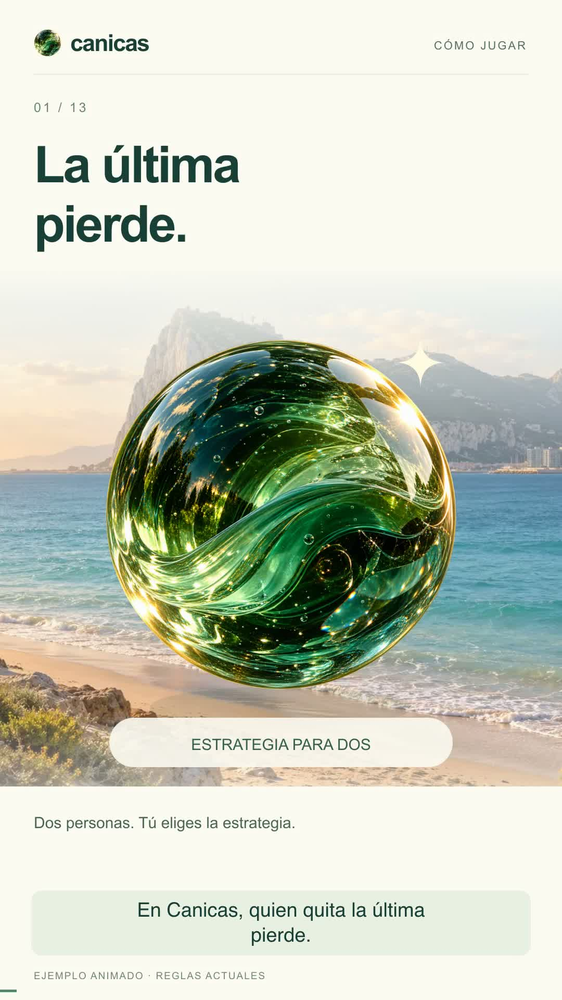

# Canicas Try Again

Un duelo de estrategia para dos: elige canicas, guarda tu dado para el momento adecuado y deja la última a tu rival.

[](docs/video/CANICAS_COMO_JUGAR_59s.mp4)

**[Ver el vídeo](docs/video/CANICAS_COMO_JUGAR_59s.mp4)** · [Guion y subtítulos](docs/video/guion/) · [Arquitectura](docs/ARQUITECTURA.md) · [Pruebas](docs/PRUEBAS.md)

## Qué incluye

- Mesas de **1 a 100 filas**, elegidas por quien crea la partida; vista general y zoom hasta el 200 %.
- Hasta **cinco partidas simultáneas**. Caducan tras **24 horas sin jugadas**, renovadas por cada acción válida.
- Invitaciones por código o enlace privado para WhatsApp. El enlace pendiente dura cinco minutos; al entrar el rival comienza la partida para ambos.
- Dado de ocho poderes, tirada antigua con puntería y fuerza, resurrección aleatoria y reglas comprobadas en el servidor.
- Interfaz móvil y de escritorio, modos claro/oscuro, canicas de cristal y dos capas de parallax.
- **La Línea y Gibraltar** como escenario principal; Cádiz, Tarifa y naturaleza como alternativas. Navidad, Halloween, Semana Santa y eventos administrables.
- Cumpleaños de cuentas registradas: fondo, canicas y dado personalizados el día anterior, el propio día y el siguiente. Solo se guarda día y mes, sin año.
- Ranking, rivales anteriores, aplicación instalable y práctica sin conexión en `/demo`.

## Jugar

La fila n tiene n canicas. En cada jugada normal retira un bloque de canicas vivas consecutivas de **una sola fila**, sin saltar huecos. El máximo es el número de jugada global: primero una, después hasta dos, luego tres… Puedes quitar menos. **Quien retira la última pierde**, también con un poder.

Cada jugador tiene un único uso del dado, que consume turno. Sus ocho resultados son equiprobables:

| Poder | Efecto |
| --- | --- |
| Bomba | Vacía una fila activa al azar. |
| Rayo | Quita una canica al azar de cada fila activa. |
| Diagonal | Quita el origen y sus diagonales. |
| Resurrección | Devuelve entre una y todas las eliminadas, al azar por toda la mesa. |
| Avalancha | Eliges el origen; baja por las ramas inferiores y se detiene en los huecos. |
| Remolino | Mezcla vivas y huecos dentro de cada fila, sin alterar su cantidad. |
| Fantasma | Quita el origen y la viva más cercana a cada lado, saltando huecos. |
| Tirada antigua | Apunta con dedo o ratón, mantén para cargar y suelta. Los choques eliminan y consumen fuerza; la lanzada se retira al parar. |

## Ejecutar en local

Requiere Node.js **22 o 24 LTS** y npm. Los contenedores utilizan Node 22. [Calendario oficial de versiones](https://nodejs.org/en/about/previous-releases).

```sh
npm ci
cp .env.example .env.local
npm run dev
```

Abre `http://localhost:13000` o `http://localhost:13000/demo`. SQLite se inicializa y migra automáticamente. `npm run db:migrate` permite ejecutar las migraciones explícitamente. Para probar desde otro dispositivo de tu red usa `npm run dev:host` y la dirección local del ordenador.

Para producción sin Docker:

```sh
npm run build
npm start
```

Next.js abre el puerto 3000 por defecto en producción. La base se guarda en `data/game.db`; no se versiona.

## Docker y despliegue

```sh
docker compose up --build -d
```

La aplicación queda en `http://localhost:3000`, con SQLite en el volumen persistente `sqlite_data`. El contenedor ejecuta producción con usuario sin privilegios, healthcheck, límites de memoria/CPU y rotación de logs. Antes de actualizar una instalación real, crea una copia consistente de SQLite y conserva el volumen.

Configura `PUBLIC_ORIGIN=https://tu-dominio` cuando haya un proxy HTTPS. Consulta [.env.example](.env.example), el [proxy Nginx de ejemplo](deploy/nginx.conf.example) y [Portainer](PORTAINER.md). SSE necesita buffering desactivado y los encabezados de origen correctos.

SQLite debe estar en almacenamiento local persistente. No montarlo en NFS ni compartir el archivo entre máquinas. El transporte admite varios procesos en la misma máquina; para desplegar en varios servidores haría falta cambiar la persistencia y la distribución de eventos. Los resultados de carga locales no garantizan capacidad en un VPS o red concretos.

## Verificar los cambios

```sh
npm test
npm run build
npm audit --omit=dev --audit-level=high
```

La batería incluye seguridad, perfiles/cumpleaños, reglas, ocho poderes, física, 100 filas/zoom, eventos, ranking/rivales, invitaciones, reconexión, deltas, SSE, PWA y smoke tests de desarrollo/producción. Los scripts HTTP y de carga solo se ejecutan contra un servidor y una base desechables, con sesiones válidas. Instrucciones en [Pruebas](docs/PRUEBAS.md).

La plantilla de GitHub Actions está en [scripts/ci-github-actions.yml](scripts/ci-github-actions.yml). Consulta [Publicación](docs/PUBLICACION.md) para activarla; no se afirma que CI esté activa mientras la plantilla no exista en `.github/workflows/` en GitHub.

## Aspecto y recursos

El administrador puede subir fondos y asignarlos al club, a una fiesta o a una persona. El usuario puede seguir el calendario, omitir personalizaciones o conservar su escenario habitual. Semana Santa se calcula cada año; las ediciones con año caducan.

El cumpleaños se configura al registrarse o en **Aspecto → Tu cumpleaños**. Se recupera en otra sesión, solo se aplica automáticamente a cuentas autenticadas y respeta la desactivación de eventos. Para el 29 de febrero se usa el 28 en años no bisiestos.

Los catálogos y los recursos originales están en `src/features/appearance/` y `artwork/`. Los formatos optimizados están en `public/worlds/` y `public/glass/`. Los scripts `assets:sceneries`, `assets:worlds`, `assets:world-photos` y `assets:glass` preparan recursos sin procesarlos durante una petición; los codificadores requieren Sharp. Ver [Arquitectura](docs/ARQUITECTURA.md).

El vídeo y sus fuentes editables están en [docs/video](docs/video/). `npm run video:preview` abre un servidor local en el puerto 13008; `npm run video:render` reconstruye el montaje con FFmpeg, Python 3, Node y Sharp. La narración ya está incluida: no requiere una cuenta ni un servicio externo de voz.

## Licencia

**Uso no comercial, gratuito y sin ánimo de lucro**, según la [licencia del proyecto](LICENSE). La explotación comercial y la promoción oficial están reservadas a los titulares o a quienes autoricen por escrito. Compartir el enlace para jugar e invitar a amigos está permitido. Es una licencia propia con restricciones de finalidad; las dependencias y fuentes conservan sus licencias originales.
