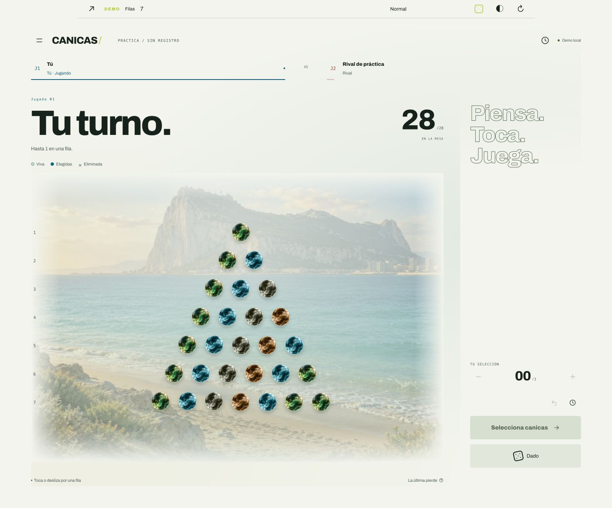
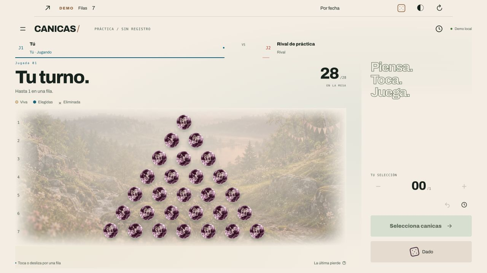

# Canicas Try Again

**Deja la última canica a tu rival.** Un duelo de estrategia para dos, con canicas de cristal, un dado de ocho poderes y escenarios que acompañan las estaciones y tus celebraciones.

Repositorio oficial: **[webcvalejandropina-ui/canicastryagain](https://github.com/webcvalejandropina-ui/canicastryagain)**.

Juega desde el móvil, la tableta o el ordenador. Invita a una persona por enlace o código, o practica contra el ordenador sin registrarte.



**[Ver cómo se juega en 59 segundos](docs/video/CANICAS_COMO_JUGAR_59s.mp4)** · [Guion y subtítulos](docs/video/guion/) · [Arquitectura](docs/ARQUITECTURA.md) · [Pruebas](docs/PRUEBAS.md)

## Contenido

- [Empezar a jugar](#empezar-a-jugar)
- [Reglas de la partida](#reglas-de-la-partida)
- [Los ocho poderes del dado](#los-ocho-poderes-del-dado)
- [Jugar en ordenador](#jugar-en-ordenador)
- [Jugar en móvil](#jugar-en-móvil)
- [Jugar contra el ordenador](#jugar-contra-el-ordenador)
- [Invitaciones, varias partidas y duración](#invitaciones-varias-partidas-y-duración)
- [Cuenta, ranking y rivales](#cuenta-ranking-y-rivales)
- [Escenarios, eventos y cumpleaños](#escenarios-eventos-y-cumpleaños)
- [Instalar la aplicación y jugar sin conexión](#instalar-la-aplicación-y-jugar-sin-conexión)
- [Ejecutar en local](#ejecutar-en-local)
- [Desplegar el servidor](#desplegar-el-servidor)
- [Arquitectura y conectividad](#arquitectura-y-conectividad)
- [Pruebas y mantenimiento](#pruebas-y-mantenimiento)
- [Vídeo y material explicativo](#vídeo-y-material-explicativo)
- [Problemas frecuentes](#problemas-frecuentes)
- [Licencia](#licencia)

## Empezar a jugar

Con la aplicación levantada:

| Quiero… | Dónde y cómo |
| --- | --- |
| Aprender sin esperar a nadie | Abre `/demo`: juegas contra un rival automático. |
| Jugar con otra persona | Desde el menú, crea una partida, elige las filas y comparte el enlace privado o el código. |
| Entrar en una invitación | Abre el enlace recibido o introduce el código en el menú. |
| Retomar una mesa | Entra en tu lista de partidas y elige la que quieras continuar. |
| Ver la clasificación | Abre **Ranking** en el menú (`/#ranking`). |

**Primera partida recomendada:** prueba pocas filas en la demo. Selecciona una canica y confirma con **Quitar**. Espera la respuesta del ordenador y fíjate en cómo crece el máximo de canicas permitido en cada turno.

## Reglas de la partida

### Objetivo y tamaño del tablero

Compiten dos jugadores por turnos. **Quien retira la última canica pierde**, también si la elimina usando el dado. Dejar una sola canica no termina la partida: el rival todavía puede disponer de su dado.

Quien crea la mesa elige entre **1 y 100 filas**. La primera tiene una canica, la segunda dos y así sucesivamente. El total es `filas × (filas + 1) / 2`: siete filas son 28 canicas; cien filas son 5.050.

### Una jugada normal

1. Espera a que sea tu turno.
2. Selecciona un bloque de canicas vivas **consecutivas de una sola fila**.
3. Comprueba la selección y pulsa **Quitar** para confirmar.
4. Pasa el turno al rival.

No puedes cruzar un hueco dejado por una canica eliminada, mezclar filas ni superar el máximo de ese turno. Puedes elegir un bloque interior; no tiene que estar en un extremo.

El máximo sigue el **número de jugada global**, compartido por ambos jugadores:

| Jugada de la partida | Máximo en una jugada normal |
| --- | --- |
| Primera | 1 canica |
| Segunda | Hasta 2 |
| Tercera | Hasta 3 |
| Cuarta y siguientes | Hasta 4, 5, 6… respectivamente |

Puedes retirar menos del máximo. Por ejemplo, en la cuarta jugada puedes quitar dos canicas contiguas aunque se permitan cuatro. Una fila `● ● × ●` permite seleccionar las dos primeras juntas, pero no unirlas con la última atravesando el hueco.

Las jugadas de dado también consumen turno y avanzan este contador. Sus efectos no están limitados por el máximo de una selección normal.

## Los ocho poderes del dado

Cada jugador puede usar el dado **una sola vez por partida**, durante su turno, en lugar de hacer una jugada normal. Hay ocho resultados con la misma probabilidad: **1 de 8** cada uno. En una partida online el resultado lo decide el servidor.

| Poder | Qué sucede | Tu intervención |
| --- | --- | --- |
| **Bomba** | Elimina todas las canicas vivas de una fila activa elegida al azar. | Automático. |
| **Rayo** | Elimina una canica al azar de cada fila que tenga alguna viva. | Automático. |
| **Diagonal** | Elimina un origen aleatorio y las canicas vivas de sus cuatro diagonales. | Automático; las diagonales atraviesan huecos. |
| **Resurrección** | Devuelve entre una y todas las canicas eliminadas, elegidas al azar por toda la mesa. | Automático; no se limita a una fila. Si no hay eliminadas, no devuelve ninguna. |
| **Avalancha** | Elimina el origen elegido y se ramifica hacia las dos posiciones inferiores de cada canica alcanzada. | Elige una canica viva. Cada rama se detiene si encuentra un hueco. |
| **Remolino** | Mezcla la posición de canicas vivas y huecos dentro de cada fila. | Automático; conserva la cantidad viva de cada fila. |
| **Fantasma** | Elimina el origen y la canica viva más cercana a cada lado de su fila, saltando huecos. | Elige una canica viva. Si no existe vecina en un lado, no elimina ninguna allí. |
| **Tirada antigua** | Lanzas una canica; las colisiones eliminan otras y consumen energía. La lanzada se retira al detenerse. | Elige origen, dirección y fuerza. |

Cuando un poder necesita un origen o un lanzamiento, termina esa acción para completar el turno. **Vaciar la mesa con cualquier poder también te hace perder.**

### Tirada antigua, paso a paso

1. Al obtener este poder, elige una canica viva como proyectil.
2. Apunta con la línea de dirección, como en el billar.
3. Mantén pulsado para cargar. La barra cambia a **ritmo variable**: debes soltar en el momento adecuado; mantener más tiempo no garantiza más fuerza.
4. Suelta para lanzar. Verás el recorrido y las eliminaciones por choque hasta que se agote la energía.

La guía indica la dirección inicial, no una predicción exacta de todos los rebotes. La física y las eliminaciones se resuelven con las mismas reglas para ambos jugadores.

## Jugar en ordenador

Funciona desde el navegador en PC, Mac y Linux; no requiere instalar un programa. El tablero se adapta al tamaño de la ventana.

| Acción | Ratón y teclado |
| --- | --- |
| Seleccionar canicas | Haz clic en una canica y ajusta el bloque de esa fila mediante clics o arrastre. Revisa lo marcado antes de confirmar. |
| Confirmar o corregir | Usa **Quitar**, los controles de selección y cancelar. Marcar una canica no la elimina inmediatamente. |
| Navegar sin ratón | Usa **Tab** para entrar en los controles. En las canicas, las flechas desplazan el foco; **Inicio/Fin** van a los extremos vivos de la fila. **Enter/Espacio** activa la canica enfocada. |
| Tirar el dado | Haz clic en el dado disponible. También puedes enfocar su botón y pulsar **Enter/Espacio**. |
| Apuntar en Tirada antigua | Elige la canica y mueve el ratón para orientar la línea. Mantén el botón izquierdo sobre el tablero o el botón de carga; suelta para lanzar. |
| Ajustar el tiro con precisión | Abre **Ajustar dirección**, modifica el deslizador y utiliza el botón de carga. Con el botón enfocado, mantén **Espacio/Enter** y suelta. **Escape** cancela la carga. |
| Explorar una mesa grande | Usa **+**, **−**, **Ver todo** y el desplazamiento del tablero. |

### Zoom para mesas grandes

Las mesas grandes ofrecen una vista general para localizar las zonas con canicas. Pulsa una zona para acercarte: **esa pulsación no confirma una jugada**. Después selecciona las canicas a una escala cómoda.

El zoom permite llegar al **200 %** y **Ver todo** recupera el encuadre general. Los controles aparecen cuando el tamaño del tablero lo requiere. La aplicación monta las zonas visibles de las mesas grandes para limitar el trabajo del navegador.

## Jugar en móvil

El móvil utiliza las mismas reglas, mesas y partidas que el ordenador.

- **Selección normal:** toca las canicas para ajustar el bloque de una fila y confirma con **Quitar**. Puedes arrastrar horizontalmente dentro de la fila; en mesas desplazables, el gesto vertical permite recorrer el tablero.
- **Dado:** tócalo o utiliza el gesto de deslizamiento sobre él cuando esté disponible.
- **Tirada antigua:** toca para elegir la canica. Mantén y arrastra para orientar el tiro; suelta para lanzar. Un toque breve de selección no dispara por sí solo. También están disponibles el ajuste de dirección y el botón de carga.
- **Mesas grandes:** localiza primero la zona en la vista general y acércate antes de seleccionar.
- **Aspecto:** claro, oscuro y automático; puedes reducir los efectos o conservar el escenario normal.

El fondo, la decoración de eventos y las animaciones acompañan la partida sin cambiar el área de selección ni sus reglas. Se respeta la preferencia de movimiento reducido del dispositivo.

## Jugar contra el ordenador

**`/demo` es el modo de práctica contra el ordenador**, disponible tanto en móvil como en escritorio, sin registro ni un segundo jugador.

- El rival responde automáticamente después de tu turno.
- Comparte el motor de reglas, los ocho poderes y la física con las partidas online.
- Puedes elegir entre 1 y 100 filas, reiniciar, alternar claro/oscuro y previsualizar eventos.
- El control **Probar poderes del dado** permite elegir un resultado para aprender su funcionamiento cuando tu dado y tu turno estén disponibles. En las partidas online no se puede elegir el resultado.
- No concede puntos de ranking ni crea una invitación multijugador. Es práctica local; no se garantiza conservar la ronda al recargar.

El rival automático permite aprender y comprobar jugadas; no ofrece niveles de dificultad ni se presenta como una inteligencia invencible. La práctica puede funcionar sin conexión una vez preparada la aplicación.

## Invitaciones, varias partidas y duración

### Jugar por enlace privado, WhatsApp o código

1. Crea una partida y elige el número de filas.
2. Comparte el **enlace privado** con la persona elegida. La opción de WhatsApp prepara el mensaje con el acceso a la mesa; también puedes copiar el enlace o compartir el código.
3. Al abrir una invitación válida, el rival accede con su código incorporado y la partida comienza para ambos sin tener que escribirlo manualmente.

El enlace pendiente dura **cinco minutos**. La imagen de vista previa necesita que el servidor esté publicado y accesible para WhatsApp; un enlace `localhost` solo funciona en el ordenador que lo genera. En producción configura el origen público correcto.

Quien recibe un enlace privado puede entrar como invitado. Guarda el enlace con cuidado: está pensado para la persona con quien quieres jugar.

### Hasta cinco mesas a la vez

Puedes mantener **hasta cinco partidas simultáneas** y abrir cada una desde tu lista. El turno, el tablero y el dado disponible pertenecen a cada partida.

Una partida caduca tras **24 horas de inactividad**. Cada acción válida guardada renueva ese plazo. No es una cuenta atrás fija de 24 horas desde la creación ni un límite de tiempo individual por turno. Cerrar una pestaña no equivale a abandonar expresamente la partida.

Las invitaciones de **Tus rivales** tienen su propio flujo: el rival acepta desde su menú y entonces se crea la mesa. Esas invitaciones caducan en 24 horas; no son el enlace privado pendiente de cinco minutos.

## Cuenta, ranking y rivales

### Perfil opcional

Puedes practicar sin cuenta. Registrarte permite recuperar tu perfil al iniciar sesión y configurar tu cumpleaños. Las cuentas nuevas requieren alias y contraseña de al menos ocho caracteres.

Puedes añadir **edad y localidad**, de forma opcional. La localidad se introduce manualmente y sirve para adaptar eventos locales; no requiere ubicación GPS. El cumpleaños guarda **día y mes, sin año**; indicar la edad no sustituye esa fecha.

### Clasificación

El ranking muestra puntos, victorias, partidas y porcentaje de victorias. La puntuación depende del resultado y de la diferencia entre tu porcentaje de victorias y el del rival: ganar a alguien con mejores resultados concede más puntos. Para calcular puntos, un jugador sin partidas tiene una referencia inicial del 50 %.

| Porcentaje del rival respecto al tuyo, en puntos porcentuales | Victoria | Derrota |
| --- | --- | --- |
| 30 o más por encima | +15 | −2 |
| Entre 15 y 29,99 por encima | +13 | −4 |
| Entre 5 y 14,99 por encima | +12 | −5 |
| Diferencia entre −4,99 y +4,99 | +10 | −6 |
| Entre 5 y 14,99 por debajo | +8 | −8 |
| Entre 15 y 29,99 por debajo | +7 | −10 |
| 30 o más por debajo | +5 | −12 |

**Abandonar penaliza con −18 puntos.** La práctica contra el ordenador no puntúa. Los desempates del ranking usan victorias, porcentaje de victorias y partidas, en ese orden tras la puntuación.

### Volver a jugar con alguien

En **Tus rivales** aparecen las personas con las que has jugado, las partidas compartidas y la última vez que coincidisteis. Puedes invitar a una revancha con las filas elegidas, aceptar o rechazar invitaciones y quitar personas de tu lista.

**Quitar** oculta al rival: no borra su cuenta ni las partidas. Puedes recuperarlo desde **Rivales ocultos**.

## Escenarios, eventos y cumpleaños

### Un escenario habitual y un calendario de celebraciones

El escenario principal representa **La Línea y Gibraltar**. **Cádiz**, **Tarifa** y **Naturaleza** son alternativas. El fondo mantiene dos capas de parallax y detalles ambientales discretos; el servidor no renderiza una animación por cada jugador.

Los ambientes pueden combinar fondo, canicas de cristal, dado y clima. Incluyen Halloween, Navidad, verano y cumpleaños; Semana Santa dispone de escenario y fechas calculadas cada año. El catálogo se puede ampliar con ferias, fiestas patronales y eventos locales de España u otros lugares: no está limitado a un único calendario ni a una lista cerrada de ciudades.

En **Aspecto**, el usuario decide:

| Preferencia | Resultado |
| --- | --- |
| Automático | Sigue las fechas y las personalizaciones permitidas. |
| Solo calendario | Mantiene los eventos, omitiendo las sustituciones personales y del club. |
| Conservar siempre mi escenario habitual | Conserva el fondo habitual y desactiva los cambios automáticos por eventos y administrador. |
| Ambiente manual | Permite elegir un ambiente en lugar del calendario automático. |

También puedes ajustar el color de la interfaz y los efectos. Los detalles de clima, como lluvia de invierno o nieve, son decorativos; puedes desactivarlos. Las animaciones se detienen al ocultarse la pestaña o salir el fondo de pantalla.

### Cumpleaños durante tres días

Con una **cuenta registrada y autenticada** y el cumpleaños guardado, se activa una celebración con fondo, canicas y dado personalizados:

- El día anterior al cumpleaños.
- El propio día.
- El día siguiente.

Se configura al registrarse o en **Aspecto → Tu cumpleaños**, y se recupera al iniciar sesión en otro dispositivo. Se utiliza el calendario de **Europe/Madrid**, incluso al cambiar de mes o año. El 29 de febrero se celebra el 28 en años no bisiestos. La elección manual de ambiente y la opción de conservar el escenario habitual se respetan.



### Administración y ampliación del catálogo

Una cuenta con permisos de administrador puede gestionar fondos, eventos y asignaciones sin cambiar las reglas del juego:

- Subir imágenes a la biblioteca y reutilizarlas.
- Asignar un fondo al club, a una fiesta o a una persona concreta.
- Definir eventos anuales, una edición con año, fechas relativas a Pascua o una asignación permanente.
- Establecer localidad, prioridad, ambiente, escenario y clima por separado.

En automático, el cumpleaños autenticado tiene prioridad sobre las sorpresas personales, las sustituciones del club y el calendario general. El usuario mantiene sus opciones para omitirlas. Las imágenes subidas se validan en el servidor y las operaciones requieren permisos; registrarse no concede acceso de administrador.

Consulta [Escenarios y calendario](docs/ARQUITECTURA.md) para el orden completo de prioridades y cómo incorporar recursos. El catálogo es ampliable: no implica que estén incluidas todas las fiestas patronales de España.

## Instalar la aplicación y jugar sin conexión

Canicas es una **PWA**, una web que puede instalarse donde el navegador lo permita:

- **iPhone/iPad:** abre el menú Compartir y elige **Añadir a pantalla de inicio**.
- **Android:** utiliza **Instalar aplicación** o **Añadir a pantalla de inicio**, según el navegador.
- **Ordenador:** utiliza la opción de instalación del navegador si está disponible; también puedes jugar directamente en la web.

La instalación y el service worker requieren **HTTPS o localhost** y una compilación de producción. En desarrollo no se activa la caché PWA para evitar versiones antiguas del código.

Abre la aplicación con conexión y espera a **Práctica preparada para jugar sin conexión**. Después podrás practicar en `/demo` sin red. Las partidas contra otras personas **necesitan conexión**: no se guardan órdenes offline para enviarlas más tarde ni se cachean públicamente los datos privados de las partidas.

## Ejecutar en local

### Requisitos

- Node.js **22 o 24**, de acuerdo con `package.json`; `.nvmrc` fija la rama 22.
- npm y una terminal en la carpeta del proyecto.
- SQLite está integrado mediante `better-sqlite3`; no necesitas un servidor de base de datos separado.

### Desarrollo

```sh
npm ci
cp .env.example .env.local
npm run dev
```

Abre **http://localhost:13000** para el menú o **http://localhost:13000/demo** para practicar. La base se inicializa y migra automáticamente; `npm run db:migrate` permite ejecutar las migraciones explícitamente.

Para acceder desde un móvil de la misma red:

```sh
npm run dev:host
```

En el móvil abre `http://IP-LOCAL-DEL-ORDENADOR:13000`. Ambos dispositivos deben poder comunicarse y el cortafuegos debe permitir ese puerto. `localhost` en el teléfono se refiere al propio teléfono. Para probar instalación PWA fuera de localhost, utiliza HTTPS.

### Producción sin Docker

```sh
npm run build
npm start
```

El puerto de producción es **3000** por defecto. Puedes cambiarlo con `PORT`. La base local por defecto es `data/game.db`; no se versiona. Conserva ese archivo y su almacenamiento al actualizar.

### Variables de entorno

| Variable | Uso |
| --- | --- |
| `PUBLIC_ORIGIN` | Origen público completo, por ejemplo `https://canicas.example.com`. Necesario tras un proxy HTTPS y para enlaces públicos coherentes. Vacío solo para desarrollo HTTP local. |
| `SQLITE_PATH` | Ruta a SQLite en almacenamiento local persistente. En Docker se utiliza `/app/data/game.db`. |
| `GAME_STREAM_LIMIT` | Máximo de conexiones SSE por proceso; el ejemplo utiliza `1000`. Al alcanzar el límite se emplea transporte HTTP alternativo. No equivale a una garantía de mil jugadores. |
| `INVITE_TOKEN_SECRET` | Opcional: clave de firma de al menos 32 bytes aleatorios. Si se omite, se genera una clave privada por instalación, persistida en SQLite y compartida entre procesos. |
| `PORT` | Puerto HTTP del proceso en producción; `3000` por defecto. |

Usa [.env.example](.env.example) como referencia. No subas `.env.local`, contraseñas, sesiones ni bases reales al repositorio.

## Desplegar el servidor

### Docker Compose

```sh
docker compose up --build -d
```

La web queda disponible en **http://localhost:3000**. El volumen **`sqlite_data`** conserva la base. La configuración incluye usuario sin privilegios, healthcheck, logs con rotación y límites de CPU/memoria. La imagen utiliza Node 22 y la salida standalone de Next.js.

Antes de actualizar una instalación real, crea una copia consistente de SQLite y conserva su volumen. No elimines el volumen si quieres mantener cuentas, partidas y configuración.

### Dominio, proxy y persistencia

Configura `PUBLIC_ORIGIN` con tu dominio HTTPS. Para SSE, el proxy debe desactivar el buffering y conservar correctamente el origen y la conexión. Consulta el [ejemplo de Nginx](deploy/nginx.conf.example) y la [guía de Portainer](PORTAINER.md).

SQLite debe residir en disco local persistente: **no compartir el archivo entre máquinas ni montarlo en NFS**. Se admiten varios procesos en la misma máquina con la misma base local. Desplegar en varios servidores requiere adaptar persistencia y distribución de eventos.

Los límites del contenedor y las pruebas locales ayudan a dimensionar, pero la capacidad real depende del servidor, de las mesas y de la red. Revisa las [mediciones y sus límites](docs/PRUEBAS.md) antes de planificar carga de producción.

## Arquitectura y conectividad

La aplicación utiliza **Next.js, React, TypeScript y SQLite**. Las reglas se ejecutan en el servidor; el cliente presenta el tablero, recoge los gestos y anima los resultados.

| Área | Responsabilidad |
| --- | --- |
| `src/backend/game/domain/` | Reglas, final de partida, ocho poderes y física de Tirada antigua. |
| `src/backend/game/application/` | Casos de uso de creación, entrada, jugadas, dado y abandono. |
| `src/backend/game/infrastructure/` | Persistencia, revisiones y distribución de eventos. |
| `src/features/game/` | Interfaz de partida, selección, zoom, dado y reproducción de animaciones. |
| `src/features/demo/` | Práctica local contra el ordenador usando el dominio compartido. |
| `src/features/appearance/` | Preferencias, calendario, escenarios, materiales y efectos. |
| `artwork/`, `public/worlds/`, `public/glass/` | Originales gráficos y recursos optimizados para servir. |

La comunicación utiliza **SSE con deltas y revisiones**, recuperación al reconectar y alternativa HTTP. Los comandos antiguos o repetidos no deben volver a aplicar una jugada. Tras una interrupción, la interfaz recupera el estado autorizado antes de continuar; recargar no debe inventar movimientos.

Las animaciones del dado, las canicas y las dos capas de parallax se ejecutan en el dispositivo. Las imágenes se preparan antes del despliegue y se sirven con caché; no se generan durante una petición ni se envía cada fotograma por la red.

Las operaciones privadas autentican al actor con cookies HttpOnly y validan permisos, origen y datos en el servidor. Las medidas y pruebas reducen riesgos, sin prometer inmunidad a cualquier ataque. Para comunicar un problema consulta [Seguridad](SECURITY.md).

## Pruebas y mantenimiento

### Comprobación general

```sh
npm test
npm run build
npm audit --omit=dev --audit-level=high
```

`npm test` incluye lint, sesiones/seguridad, inactividad, PWA, física, geometría del dado y ocho poderes, reglas, 1–100 filas y zoom, perfiles/cumpleaños, eventos, rivales, demo, invitaciones, deltas, conectividad, capacidad SSE y smoke tests. La comprobación Docker incluida revisa la configuración; no equivale por sí sola a ejecutar la imagen.

### Comprobaciones por área

| Comando | Área |
| --- | --- |
| `npm run test:rules` | Reglas normales y final de partida. |
| `npm run test:powers` | Ocho poderes, geometría y persistencia del dado. |
| `npm run test:ancient` | Física y persistencia de Tirada antigua. |
| `npm run test:rows` | Número de filas y vista del tablero. |
| `npm run test:profile` | Perfil y cumpleaños. |
| `npm run test:appearance` | Calendario, fondos y recursos visuales. |
| `npm run test:private` | Invitaciones privadas y acceso HTTP. |
| `npm run test:connectivity` | Sincronización y recuperación. |
| `npm run test:pwa` | Instalación, caché y práctica offline. |

Los scripts HTTP y de carga requieren las condiciones descritas en [Pruebas](docs/PRUEBAS.md): usa un servidor y una base **desechables**, con sesiones válidas. No ejecutes cargas contra datos reales. Las comprobaciones en emuladores no certifican todos los navegadores ni todos los móviles físicos.

La plantilla de CI está en [scripts/ci-github-actions.yml](scripts/ci-github-actions.yml). Para activarla en GitHub sigue [Publicación](docs/PUBLICACION.md); tener la plantilla no significa que GitHub Actions ya esté ejecutándose.

Para preparar imágenes, utiliza `npm run assets:sceneries`, `npm run assets:worlds`, `npm run assets:world-photos` o `npm run assets:glass`, según el recurso. Los codificadores requieren Sharp. Las pautas de cambios están en [Contribuir](CONTRIBUTING.md).

## Vídeo y material explicativo

El [vídeo de 59 segundos](docs/video/CANICAS_COMO_JUGAR_59s.mp4) explica el objetivo, la selección, el dado y las invitaciones con material del juego. Los originales editables, capturas, narración, guion y subtítulos están en [docs/video](docs/video/).

```sh
npm run video:preview
```

Abre **http://localhost:13008/VER_VIDEO.html** para ver el montaje localmente.

```sh
npm run video:render
```

Reconstruye el vídeo con FFmpeg, Python 3, Node y Sharp. La narración está incluida: no requiere cuenta ni servicio externo de voz. Consulta las instrucciones y recursos de la carpeta del vídeo antes de editar el montaje.

## Problemas frecuentes

| Problema | Qué revisar |
| --- | --- |
| El móvil no abre el enlace local | Usa la IP del ordenador, ejecuta `dev:host` y revisa red y cortafuegos. Un enlace localhost no sirve para invitar por Internet. |
| El enlace privado ya no deja entrar | Comprueba su plazo de cinco minutos; prepara una nueva invitación si ha caducado. |
| No puedo crear otra partida | Revisa si ya tienes cinco mesas simultáneas. |
| No puedo seleccionar una canica | Comprueba turno, conexión y si el poder pendiente necesita un origen. En vista general, acércate primero. |
| No puedo unir dos grupos de una fila | Una selección normal no puede atravesar canicas eliminadas. |
| No aparece mi cumpleaños | Inicia sesión, guarda día y mes y utiliza Automático con eventos permitidos. Comprueba la ventana de tres días. |
| No veo un evento local | Comprueba localidad, fechas, prioridad y preferencias de Aspecto. |
| No aparece la instalación o el modo offline | Usa producción con HTTPS o localhost; abre antes con conexión y espera la preparación de la práctica. La instalación depende del navegador. |
| La partida tarda en actualizarse tras un proxy | Revisa SSE, buffering, origen público, límites de conexiones y transporte HTTP alternativo. |
| WhatsApp no muestra la imagen del enlace | El origen y la imagen deben ser accesibles públicamente; revisa `PUBLIC_ORIGIN`. La vista previa también depende de la caché de WhatsApp. |

## Licencia

**Uso no comercial, gratuito y sin ánimo de lucro**, conforme a la [licencia del proyecto](LICENSE). La explotación comercial y la promoción oficial están reservadas a los titulares o a quienes autoricen por escrito. Compartir el enlace para jugar e invitar a amigos está permitido.

Es una licencia propia con restricciones de finalidad. Las dependencias, las fuentes y otros recursos de terceros conservan sus respectivas licencias.
